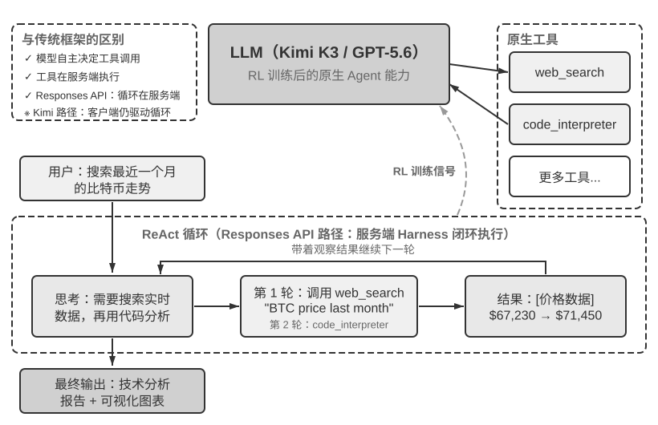
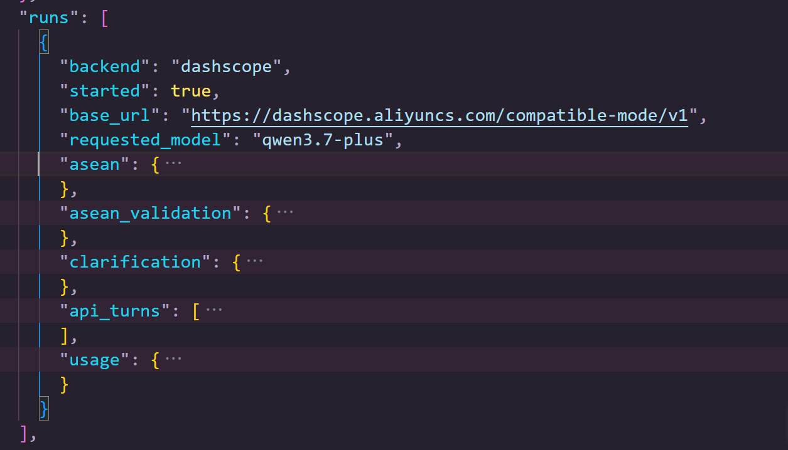

# 《深入理解 AI Agent》第 1 章 · 学习记录

> 个人学习笔记 / 打卡记录。书中原文用 `>` 引用块标出，其余是我的批注、实测与思考。
> 实测产物路径均相对于仓库根目录（`chapterN/...`），便于回溯。

---

## 一、核心概念：Agent = Model + Harness

起点是几个零散词：**manus**、**AI 浏览器插件**、**agent 和强化学习的映射关系**——强化学习本质就是 agent 和固有环境的不断交互。

**agent 的三段式比喻**：大脑是 LLM，眼睛是上下文，手脚是工具。

**上下文有哪几类**（类似 agent 的执行轨迹）：系统指令、工具定义、思考过程、历史消息、工具结果。

映射到消息层面就是：`system`、`tool define`（静态前缀）、`user message`、`tool result`、`assistant message`（动态消息历史）。这里也验证了一点：**工具的使用信息本身也是上下文的一部分**。

> **工具执行结果**（Tool Results）是闭环控制的关键，缺失它会让 Agent “盲目”执行，反复重试直到耗尽迭代预算。

**我的经历**：在做一个"小说转剧本"的 agent 时，第一章的 RAG tool 调用没有结果就会一直调用——正好是这句话的实例。

**职责划分**：model 只负责决定下一步；harness 负责组装上下文、工具的**校验**和执行。

LLM 会输出两种形态：

- `reasoning + tool_call`（调用工具）
- `reasoning + content`（回复用户）

这些都是 assistant message，属于同一种上下文消息。

### 1.1 harness：model 之外、agent 之内的一切

**agent = model + harness**

harness = 上下文 + 工具 + **三层机制**：

- **约束**：规定 agent 能做什么、不能做什么
- **验证**：检查 agent 做得对不对
- **纠正**：做错了怎么补救

| 功能 | 职责与核心原则 | 实际例子 | 详见 |
| --- | --- | --- | --- |
| **Context（上下文）** | 为模型提供感知信息；信息要充分，让 Agent 在每个决策点都基于足够的信息判断 | 系统提示词、知识库、Agent 状态栏、Sidecar 旁路查询 | 第二、三章 |
| **Tools（工具接口）** | 为模型提供观察与行动手段；接口要清晰，命名直观、参数有例子、边界有说明 | MCP 工具、代码解释器、搜索工具 | 第四章 |
| **Constrain（约束）** | 设定行为边界；采用故障安全默认值，所有能力默认关闭，必须显式开放（类似手机 App 权限管理） | Claude Code 中每个工具默认需要用户授权才能执行 | 第四章 |
| **Verify（验证）** | 自动判断操作结果的对错；安全检查只看结构化数据（如工具返回的 JSON 字段），而不看模型自由生成的文本，因为后者可能已被提示注入操纵 | Linter 检查、类型系统、工具调用结果校验 | 第五、六章 |
| **Correct（纠正）** | 发现问题时自动修正或回退；在确认无法恢复之前不暴露中间态，例如工具调用失败时先静默重试，不把半成品结果展示给用户 | 静默重试、接续生成、连续失败时回退到人工判断（熔断机制） | 第二、五章 |

这套循环写成伪代码大概是这样：

```python
observation = Environment.observe()              # 观察，和环境交互
trajectory = [observation]                       # 构建轨迹
while true:
    actions = Model(Harness.build_context(trajectory))   # 构建上下文，输出行为（工具调用或回答用户）
    if len(actions) == 0:                        # 工具调用结束，break 后输出 content
        break
    allowed_actions = Harness.constrain(actions)         # 校验工具调用是否合法，或给工具调用添加约束
    observation = Environment.apply(allowed_actions)     # 执行工具调用，和环境交互
    if not Harness.verify(Environment):          # 观察工具调用结果是否合法，也就是验证
        observation = Harness.correct(Environment)       # 结果不合法就纠正（这里是纠正 agent 的行为还是纠正环境，我还没想清）
    trajectory.append(allowed_actions, observation)      # 添加历史消息
```

**我的理解**：早期 agent 只注重 context 和 tool，容易出错或陷入死循环；加上约束、验证、纠正之后，闭环能力明显增强，更容易完成任务。这三个感觉是"为 context 和 tool 服务"的——约束是为了让 tool 正确调用，验证是保证上下文内容正确，纠正是给 tool 和 context 出错时兜底。

**在 LangChain 里的对应**：

- 流程状态管理 → task middleware
- 多层上下文压缩 → context middleware
- 权限分类 → human-in-the-loop
- 熔断器 → 失败重试策略（会设重试上限）
- 错误恢复机制 → checkpoint（用于回滚状态）

**边界**：约束、验证、纠错也是 harness 的一部分。harness 不是"除了模型的一切"，而是 **model 之外、agent 之内**的一切，负责协调 model 和环境的交互。工具、沙箱权限、重启机制都属于 harness。而沙箱内随行动变化的文件、进程、外部数据库、网页、用户、物理世界属于**环境**——意识到**人也是环境的一部分**。

### 1.2 工程范式的五波演进

> **提示工程**（Prompt Engineering）是第一波创新——通过优化输入给模型的自然语言指令来提升输出质量。
>
> **上下文工程**（Context Engineering）是第二波——人们认识到单纯优化提示词还不够，需要系统性地管理模型能看到的所有信息（系统指令、工具定义、对话历史、外部知识）。
>
> **Harness 工程**是第三波——它将视野从"模型能看到什么"进一步扩展到"Agent 如何组织模型运行并与环境交互"，涵盖上下文与工具接口、约束机制、验证手段、反馈循环和错误恢复等 Agent 边界内、模型之外的运行与治理机制。
>
> 随后出现的 **Loop 工程**（Loop Engineering）又把视野从单次运行扩展到跨轮次的持续自主运转：谁来发现下一件该做的事、何时验证、何时才算真正完成（第十章将结合多 Agent 协作系统展开）。
>
> 2026 年 7 月，业界又开始用 **Graph 工程**（Graph Engineering）描述一种更高层的编排视角：把 Agent 循环、确定性程序和人工审批组织成显式的执行图，其中节点承担具体能力，边规定路由与依赖，结构化状态沿边传递并在关键边界处持久化。

**我的消化**：

- **prompt engineering**：优化提示词来优化 LLM 的输出
- **context engineering**：优化上下文来优化 LLM 的输出；管理上下文包括 `system`、`tool use`、`user`、`assistant`、`tool result`
- **harness engineering**：在 model + context + tool 的基础上添加约束 + 校验 + 纠正
- **loop engineering**：我没有接触过，只是之前听过 ralph loop 可能和这个有关

关于 Ralph loop，我查到的最清晰对比：

| | Loop Engineering | Ralph loop |
| --- | --- | --- |
| 层次 | 方法论/架构学科 | 一种具体的循环模式 |
| 提出者 | Addy Osmani 命名（2026） | Geoffrey Huntley（2025） |
| 上下文 | 每轮可续用、可压缩、可路由 | **每轮全新上下文，绝不继承** |
| 记忆载体 | 状态文件/Skill/看板/MCP | 文件系统（PROMPT.md、日志、"计划"） |
| 退出条件 | 验证门禁 + 预算 + 最大迭代 | 目标达成 / 轮次上限 |
| 变体 | 回合制、目标制、定时制、主动式 | 只有一种：fresh-agent 迭代 |

关键差别在**上下文处理策略**：循环工程这个大筐里有回合制循环（续用上下文）、目标制循环（如 `/goal`）、定时制循环（如 `/loop`）等；而 Ralph 的**定义性约束**就是"每轮丢弃上下文、从零启动"——用文件系统当长期记忆来绕开上下文窗口和"上下文腐化"。所以 Ralph 不是"另一种 loop"，而是 loop 家族里"无状态迭代"这一支的原型。

我的理解是：**ralph loop + context engineering（管理上下文）+ harness engineering（管理约束校验纠正）≈ loop engineering**。

**graph engineering**：

| 层次 | 内容 | LangGraph 覆盖度 |
| --- | --- | --- |
| **Work Graph（拓扑执行）** | 节点/边、条件路由、循环、扇出聚合、子图 | ✅ 完全覆盖，这是它的本职 |
| **Work Graph（跨 run 状态）** | 持久化、恢复、断点续跑、时间旅行 | ✅ 原生（checkpointer / time travel） |
| **Org Graph（领域责任与长期上下文）** | 谁负责什么、保留该领域上下文、工具权限 | ⚠️ 有脚手架（Store / 多 agent 预置），但"责任边界"是你自己写在代码里的 |
| **动态拓扑** | 运行时改写自身结构 | ❌ 不原生 |
| **图之外的工程件** | 触发心跳、worktree 隔离、预算治理、可观测性 | ❌ 大多在框架之外 |

> 这五个阶段不是替代关系，而是层层包含的：提示工程是上下文工程的子集，上下文工程是 Harness 工程的子集，Harness 工程是 Loop 工程的子集，Loop 工程又是 Graph 工程的子集——单个 Agent 循环正是执行图中的一个节点。每一层都在前一层的基础上扩展了工程师的关注范围和影响力。**当各家模型的能力越来越接近、不再是决定性的差异因素时，竞争优势就转移到了模型之外的工程实践**。
>
> 这一判断在最近的工程实践中得到验证。LangChain 在 Terminal Bench 2.0（一个评估 Agent 在终端环境中完成复杂任务能力的基准测试）上的实践提供了一个有力例证：得分从 52.8% 提升到 66.5%（从排行榜 30 名开外跃升至前 5），改变的不是模型，而是 Harness，具体包括让 Agent 自动检查自己的执行结果、检测是否陷入重复循环、优化思考策略等工程手段。

---

## 二、编排模式：工作流与自主

> 编排模式是 Harness 中"上下文与工具"层面的组织方式——它决定了上下文如何在 LLM 调用之间流动、工具如何被调度，以及 Agent 的执行路径是预先设定还是动态生成。Agent 系统的编排方式经历了从简单到复杂的演进过程，每种模式都有其适用场景和相应的取舍。根据 Anthropic 与数十个团队合作构建 LLM Agent 的经验，最成功的实现往往不是使用复杂的框架，而是采用简单、可组合的模式。
>
> 在构建 LLM 应用时，应遵循"从简单到复杂"的原则：首先考虑单个 LLM 调用。如果通过优化提示词和上下文示例就能解决问题，就不要引入 Agent 系统。当需要多步骤处理时，对于可以清晰分解为**固定子任务**的场景，考虑使用**工作流**。**只有当需要动态决策和灵活的执行路径时，才使用自主 Agent**。需要记住的是：**Agent 系统通常会用延迟和成本换取更好的任务性能**，应该谨慎权衡这种交换是否值得。

**停止条件**（我的整理）：自主决策的 agent 必须要有自主规划的能力，还要有明确的停止条件——达到目标、到达最大尝试步数、遇到不可恢复的错误。

迁移到 ReAct 的情况，停止条件有：调用最终输出的工具、输出没有工具调用、到达最大使用次数、错误次数超出上限。

### 2.1 实验 1-4 的前置思考（当时记的）

**1-4 ★：文生图工作流与原生图像生成的对照**，体验工作流。

要做的是：体验一般的"把提示词转成 Stable Diffusion 风格再生成图"的工作流，对比"把这个能力内化"的大模型（Nano Banana 2、GPT-Image 2）。

**大模型本身会把一些 harness 的东西内化**：推理模型内化、输出格式修复内化（模型自带结构化输出）、文生图的提示词改写成适配 SD 的版本被内化。**被消灭的是"翻译"和"脚手架"这类适配层代码。**

### 2.2 一个和 workflow→skill 很像的流程

> 还有一种混合方式是**先由自主 Agent 把工作流写出来，再由工作流去执行**。Agent 读完任务后自行决定拓扑并生成一段编排代码；代码一旦生成，执行阶段就退回工作流的确定性。这样既保留了自主 Agent 面对未知任务的灵活性，又不必让模型在每一次调度上都参与决策。第十章会详细讨论这种形态。

这个感觉和另一个流程很像：**agent 自主解决问题，完成之后把遇到的问题以及工作流总结成 skill；下次遇到类似的工作和问题时，直接调用这个 skill。**

---

## 三、实验 1-1 ★★：上下文的关键作用

### 书中原文

> 通过系统性的**消融实验**（Ablation Study），我们探索了不同上下文组件对 Agent 行为的影响。实验从上述五个部分中选取了四个组件进行测试——系统提示词作为 Agent 的基本身份定义不参与消融，因为没有系统提示词，Agent 连基本的角色认知都没有，测试没有意义。如图 1-3 所示，五组对照实验包括：一组保留全部组件的完整基线，再加上四组各缺失一个组件的对照，以此观察每个组件对 Agent 性能的影响。
>
> 
>
> 实验结果揭示了每个上下文组件的作用，也揭示了它们并不同等重要。**工具定义**（Tool Definitions，静态前缀的一部分）是 Agent 行动能力的基础，没有它就无法调用任何工具；但失去行动能力不等于沉默——模型照样会给出一份格式工整、语气笃定的答案，数据却来自参数记忆，与真正基于观测得出的答案排版一模一样。它是坦白拒绝还是就地编造，主要取决于模型自身的幻觉率与诚实度；提示词里"不得自行估计"这类约束只能降低编造的概率，并不能消除。**工具执行结果**（Tool Results）是闭环控制的关键，缺失它会让 Agent "盲目"执行，反复重试直到耗尽迭代预算。**思考过程**（模型回复中的 reasoning 部分）记录的是"为什么这么做"，工具执行结果记录的是"发生了什么"；当前者可以从后者重建时，把它从历史中丢掉几乎没有代价。**历史消息**（之前轮次的用户消息、模型回复和工具执行结果）则防止了冗余操作，避免重复犯同样的错误。
>
> 这个实验的核心洞察是：**上下文决定了 Agent 能看到什么，而 Agent 只能基于它看到的信息做决策**。但组件并不等价，衡量的标准是它承载的信息能否从别处重建——"每个组件都不可或缺"这类论断要靠实测，而且模型迭代很快，同一个消融换到新模型上完全可能得出不同的结论。还有一点对工程实践更重要：**"给出了回答"不等于"完成了任务"**，上下文残缺时典型的失败不是报错退出，而是一个看上去毫无破绽的答案。

### 3.1 五组 outcome（实测汇总）

数据来源：`chapter1/context/validation/real_20261009T131816Z/evidence.json`

| 组 | outcome | task_success | 迭代 | 工具调用 | 重复 | verdict |
| --- | --- | --- | --- | --- | --- | --- |
| full | correct | true | 3 | 4 | 0 | not_assessable |
| no_history | no_terminal_response | false | 5 | 15 | 9 | no_answer |
| no_reasoning | correct | true | 4 | 5 | 0 | not_assessable |
| no_tool_calls | no_unsupported_numbers | false | 1 | 0 | 0 | no_quantities |
| no_tool_results | no_terminal_response | false | 5 | 10 | 4 | no_answer |

一句话读法：

- **full**：终止回答且符合标准
- **no_history**：到达最大步数，自动停止（重复调用 9 次）
- **no_reasoning**：回答正确，推理缺失未导致退化
- **no_tool_calls**：终止回答中没有声称任何未被给予的数字
- **no_tool_results**：到达最大步数，自动停止（重复调用 4 次）

### 3.2 五组的完整轨迹

记录五组各自的"每轮消息角色序列"（来自 `arms[].context_contract.request_roles`）。

**full**（`task_success`: true，outcome: correct，3 轮）

```text
第1轮: [system, user]
第2轮: [system, user, assistant, tool, tool, tool]
第3轮: [system, user, assistant, tool, tool, tool, assistant, tool]
```

**no_history**（`task_success`: false，outcome: no_terminal_response，5 轮触顶）

```text
第1轮: [system, user]
第2轮: [system, user]
第3轮: [system, user]
第4轮: [system, user]
第5轮: [system, user]
```

说明：每轮都只剩 system + user，历史被整个丢弃 → 模型不记得自己做过什么，反复重算。

**no_reasoning**（`task_success`: true，outcome: correct，4 轮）

```text
第1轮: [system, user]
第2轮: [system, user, assistant, tool, tool, tool]
第3轮: [system, user, assistant, tool, tool, tool, assistant, tool]
第4轮: [system, user, assistant, tool, tool, tool, assistant, tool, assistant, tool]
```

**no_tool_calls**（`task_success`: false，outcome: no_unsupported_numbers，1 轮）

```text
第1轮: [system, user]
```

说明：请求里没有工具定义，模型发不出任何 tool 调用，一轮就给出终止回答。它唯一一轮的 `final_answer` 很有意思——**把工具调用当成了纯文本输出**：

```text
<tool_call>
{"name":"convert_currency","arguments":{"amount":2.1,"from_currency":"EUR","to_currency":"USD"}}</tool_call>
</tool_call>
```

模型的 reasoning 也在纠结："We have no explicit tool list in prompt but likely can call?"——请求里没有 tools 参数，模型调不成工具，就把工具调用的 JSON 当普通文字吐了出来。

**no_tool_results**（`task_success`: false，outcome: no_terminal_response，5 轮触顶）

```text
第1轮: [system, user]
第2轮: [system, user, assistant, tool, tool, tool]
第3轮: [system, user, assistant, tool, tool, tool, assistant, tool, tool, tool]
第4轮: [system, user, assistant, tool, tool, tool, assistant, tool, tool, tool, assistant, tool]
第5轮: [system, user, assistant, tool, tool, tool, assistant, tool, tool, tool, assistant, tool, assistant, tool, tool]
```

说明：tool 消息还在（协议要求这条消息必须存在），但内容被置空 → 模型读不到任何观测，反复重调工具直到触顶。

---

## 四、实验 1-2 ★：Kimi K3 原生 Agent 能力

### 书中原文

> 这个实验展示了 **Kimi K3** 的原生 Agent 能力，体现了"模型即 Agent"的新范式。Kimi K3 是一个约 2.8 万亿参数的混合专家（MoE, Mixture of Experts）模型——可以把 MoE 想象成一个专家团队：面对不同类型的问题，系统会自动选择最合适的几位专家来作答，而不需要所有专家同时上阵，这样既保证了能力又提高了效率。它拥有 100 万 token 的上下文窗口、原生的视觉理解能力，以及始终开启的"思考模式"（thinking mode）；模型通过强化学习训练，将工具调用的**决策策略**内化为原生能力——何时调用工具、调用哪个、传什么参数都由模型自主决定，从而能够自主完成网络搜索等任务。
>
> 关键观察包括：**模型自己决定何时搜索、搜索什么，展现了真正的自主性**；它能根据搜索结果动态调整策略，自主判断信息是否充足。这里需要厘清一个常见的误解，关键在于分清两件事的归属。**强化学习写进参数的是决策**——何时该调用工具、调用哪个、传入什么参数、拿到结果后是否继续、如何把几十上百次调用串联成连贯的推理。**工具本身及其执行则由 Agent 框架（或 API 内置工具）提供**——`web_search`、`code_runner` 的真实实现、代码沙盒环境、调用的发起与结果回传，都在模型之外的基础设施里完成（Kimi 通过名为 Formula 的服务端脚本引擎运行这些官方工具）。因此编排循环并没有消失，只是决策权交给了模型；至于循环本身跑在哪里，取决于接入方式。在实验 1-3 的 Responses API 路径中，搜索、代码执行和多轮编排整体在服务端闭环完成；而在实验 1-2 的 Kimi 路径中，Formula 只负责在服务端执行搜索本身，"调用模型 → 追加工具结果 → 再次调用"的 ReAct 循环仍由客户端代码驱动（见 `chapter1/web-search-agent/agent.py` 中的 `while` 循环）。
>
> Kimi K3 在 Agent 任务中的一个突出优势是**长链工具调用的稳定性**——它能够连续执行 200～300 次工具调用而保持思考的一致性，远超多数模型在数十次调用后就开始退化的表现。K3 面向长周期编程与 Agent 工作负载优化，发布时提供 K3 Max（面向对话与 Agent 任务）与 K3 Swarm Max（面向大规模并行处理）两个规格。作为开源模型，它在软件工程和 Agent 基准测试中展现了可与顶尖闭源系统比肩的性能，证明了通过强化学习赋予模型原生 Agent 能力这条路线的有效性。

### 4.1 我要观察的：自主性怎么验证

原句是：**模型自己决定何时搜索、搜索什么，展现了真正的自主性：它能根据搜索结果动态调整策略，自主判断信息是否充足。**

实测产物：`chapter1/web-search-agent/validation/real_20261010T055908Z/evidence.json`

主窗口是 `run.trace`——一个数组，每步的 `type` 有四种：`thought`（思考）/ `action`（决定调工具，`args.query` 是模型自己定的搜索词）/ `observation`（结果回来）/ `answer`（最终回答）。

**三类证据**：

1. **自己决定搜什么**：`action.args.query` 全部由模型生成，例如
   `"ASEAN Secretariat official member states Timor-Leste formal accession 11th member date"`
2. **根据结果动态调整策略**：搜索词自己在进化——
   - 第 7 步发现英文搜不到印尼法规，**整句换成印尼语**：`UU IKN No 3 Tahun 2022 ibu kota negara...`
   - 后续又加 `site:asean.org` / `site:peraturan.go.id` / `site:mkri.id` 收紧到官方源
   - 再加日期约束（`30 Juli 2026`、`"Juli 2026"`）
3. **自主判断信息是否充足**：`thought.content` 里自己说
   - 第 9 步 `"We have enough first round. Need follow-up search..."`（还要继续）
   - 第 25 步 `"Now I have comprehensive evidence"`（够了）→ 才进 `answer`

### 4.2 轨迹结构：`iteration` = 一次模型调用

| iteration | 模型一次给的 tool_call | 实际执行 fiber |
| --- | --- | --- |
| 1 | 4 | 4 |
| 2 | 5 | 5 |
| 3 | 2 | 2 |
| 4 | 0（finish=stop） | 0 → answer |

⚠️ 一个 iteration 里出现多组 action/observation，**不是并行执行**：模型在**一次响应**里给出 N 个 tool_call（`finish_reason=tool_calls`，属"批量决策"），然后 `agent.py` 用 for 循环**逐个串行**调用 `/fibers`。

所以准确说法是：**决策批量、执行串行**。完整形状：

```text
iteration 1: think → [act×4 → obs×4]
iteration 2: think → [act×5 → obs×5]
iteration 3: think → [act×2 → obs×2]
iteration 4: think → answer
```

配套字段：`run.api_turns[*].kind`（`chat_completion` / `formula_fiber` / `formula_tools`）、`fiber_ids`（共 11 个，印证确实搜了 11 次）、`acceptance.checks.sequential_search_rounds_observed` 与 `reasoning_observed`。

---

## 五、实验 1-3 ★：GPT-5.6 原生 Deep Research 能力

### 书中原文

> 第二个实验使用 **OpenAI GPT-5.6**，展示先进模型如何借助 API 内置工具，在服务端形成 Deep Research 的"搜索—阅读—分析"编排闭环。GPT-5.6 的一个便利特性是**自由格式工具调用**（Freeform Tool Calling）。传统方式中，模型调用工具时必须把所有参数打包成严格的 JSON 格式，这就像填表格一样有很多格式限制。自由格式工具调用（在 API 中通过 `type: "custom"` 的工具类型声明）允许模型直接向工具发送原始文本（比如一段 Python 代码、一条 SQL 查询），省去了 JSON 转义的麻烦。要说明的是，这是 API 参数格式的演进，而非模型架构的革新——客户端的工具调用循环（检测 `tool_calls` → 执行 → 回传结果）逻辑保持不变，改变的只是参数从 JSON 字符串变成了原始文本。
>
> GPT-5.6 配合 Responses API 的**网络搜索和代码解释器**内置工具——这正是 Deep Research 的核心：模型能够自主搜索网络获取实时信息，并编写代码进行深度分析，实现"搜索 → 阅读 → 分析 → 再搜索"的迭代研究过程。例如，面对"东盟 10 国首都之间，最近的一对首都距离多少"这样的问题，GPT-5.6 会自动搜索各国首都的地理坐标，然后编写 Python 代码计算所有首都对之间的大圆距离，最终找出最近的一对。又如"搜索最近一个月的比特币走势，做技术分析"任务中，它能从多个金融数据源获取实时价格数据，运用专业的技术分析库计算移动平均线、RSI、MACD 等技术指标，生成可视化图表并给出交易建议。
>
> 更重要的是，GPT-5.6 将 **OpenAI Deep Research** 产品的设计理念内化到了模型层面，引入了**意图澄清过程**。当用户提出研究需求后，GPT-5.6 不会立即动手执行，而是首先通过一系列问题来澄清用户的真实意图。以"搜索最近一个月的比特币走势，做技术分析"为例，它会先问："你偏好使用哪个数据源？需要分析哪些技术指标？"通过这种交互式的意图澄清，GPT-5.6 能够生成更精准、更符合用户需求的研究报告。
>
> GPT-5.6 是"模型即 Agent"概念的一个成熟实例：网络搜索、代码解释器作为 Responses API 的内置工具在服务端闭环执行，客户端不必再自行搭建"搜索—阅读—分析"的编排框架。而意图澄清的意义在于，它让"用户说了什么"和"用户真正想要什么"之间的差距，在任务执行之前就得到了弥合。
>
> 需要说明的是，这个实验并不绑定某一家厂商。没有 OpenAI 额度的读者完全可以用具备等价托管工具的提供商复现：例如阿里云百炼 qwen3.7-plus 的 Responses API 同样内置 `web_search` 与 `code_interpreter`；Kimi K3 的 Formula 托管搜索与 `code_runner` 也属于同类能力。
>
> 图 1-5 展示了"模型即 Agent"范式下原生工具调用的完整架构，以及 Kimi K3 / GPT-5.6 在实际任务中的 ReAct 执行过程。注意图中"客户端无需手写 ReAct 循环"只对 Responses API 路径成立：两条路径都由模型决定何时调用哪个工具、工具都在服务端执行，区别在于 Kimi 路径的循环仍由客户端驱动。
>
> 

### 5.1 两种 API 范式的对比（我的整理）

| | Chat Completions（普通） | Responses |
| --- | --- | --- |
| 心智模型 | **无状态**：塞一串 messages 进去，出一条 message | **有状态**：塞输入项进去，出**一串输出项**（消息/推理/工具调用…） |
| 状态 | 每次自己把全部历史重发 | `store` + `previous_response_id` / Conversations API 让服务端存 |
| 工具 | 只有 function calling，工具全自己实现 | function calling **+ 内置托管工具**（web_search / file_search / code_interpreter / 图像生成 / computer use / MCP…） |
| 定位 | 业界事实标准，**长期仍受支持** | OpenAI 2025-03 推出，**2026 年的推荐主线** |

### 5.2 我的实测：两个任务都通过

产物：`chapter1/search-codegen/validation/runs/real_20261010T065240Z/evidence.json`

运行命令（模型由 `config.py` 决定，默认 `qwen3.7-plus`，脚本**没有** `--model` 参数）：

```bash
cd chapter1/search-codegen
python run_experiment_1_3.py --backends dashscope --reasoning high
```

验收结果：

```json
"passed": true,
"acceptance_backend": "dashscope",
"per_backend": {
  "dashscope": {
    "started": true,
    "requested_model": "qwen3.7-plus",
    "asean_passed": true,          ← 首都距离任务 ✓
    "clarification_passed": true    ← 比特币(意图澄清)任务 ✓
  }
}
```

| 任务 | 判定 | 关键检查 |
| --- | --- | --- |
| 东盟首都距离 | `asean_validation.passed: true` | 真搜网 ✓ / 真跑代码 ✓ / 结果与独立参考值吻合 ✓ |
| 比特币技术分析 | `clarification_validation.passed: true` | **先澄清后动手** ✓ / **`previous_response_id` 续接** ✓ / 报出 MA·RSI·MACD ✓ |

结果：**吉隆坡 ↔ 新加坡**（脚本内置独立参考值 309.3 km；书里 2026-07-31 的验收记录是 316.35 km，差异来自坐标数据源不同）。

**看哪些字段（`runs[0]`）**：

| 字段 | 看什么 |
| --- | --- |
| `asean` | 任务1 原始记录（`response` / `request` / `output_items` / `citations` / `response_id` / `elapsed_seconds`） |
| `asean_validation` | 任务1 判定（7 项 `checks` + `passed` + `output_types` + `independent_reference`） |
| `clarification` | 任务2 四段：`ambiguous_task` / `first`（澄清轮）/ `user_reply` / `second`（续接执行） |
| `clarification.validation` | 任务2 判定（7 项 `checks`） |
| `api_turns` | **3 次**真实 API 请求（首都 1 + 澄清 1 + 续接 1） |
| `usage` | 本次 token 用量 |

**两条最硬的证据**：

1. **服务端闭环** —— `asean_validation.output_types`：

   ```text
   reasoning → web_search_call → reasoning → web_search_call
   → reasoning → code_interpreter_call → reasoning → message
   ```

   推理、搜网、跑代码**全在一次请求里由服务端串起来**（对比实验 1-2：客户端驱动的多轮请求）。

2. **意图澄清 + 续接** —— `clarification.validation`：
   - `first_turn_clarified_before_tools: true` ← 动手之前先澄清
   - `continuation_used_previous_response_id: true` ← 第二轮通过 `previous_response_id` 接上同一任务

**本次用量与耗时**：

- `api_turns`：3 次（Responses API 是服务端闭环，单次请求就要 1~2 分钟）
- 耗时合计：约 **354 秒 ≈ 6 分钟**
- tokens：input 147,712 / output 15,427 / **total 163,139**

**澄清轮的原话**（模型在动手前问的）：

```json
"text": "用户要求搜索最近一个月的比特币走势并进行技术分析。这里存在几个模糊点需要澄清：\n\n1. **数据来源**：用户没有指定使用哪个数据源（如Binance、Coinbase、CoinMarketCap等）\n2. **技术指标**：用户没有说明需要分析哪些技术指标（如MA、RSI、MACD、布林带、成交量等）\n3. **时间周期**：虽然说了\"最近一个月\"，但没有明确是日线、4小时线还是其他周期\n\n根据硬性规则，当用户的研究请求没有明确数据来源或具体分析指标时，必须先向用户提问澄清，在用户回答之前不要调用任何工具。\n\n因此我需要先询问用户：\n- 偏好使用哪个数据源？\n- 需要分析哪些技术指标？\n- 使用什么时间周期进行分析？\n\n这是一个需要澄清的情况，我不能直接开始搜索或分析。"
```



---

## 六、实验 1-4 ★：文生图工作流与原生图像生成的对照

### 书中原文

> 让同一句大白话需求走两条路线。**工作流路线**：LLM 先把需求改写成 Stable Diffusion 风格的提示词，再调文生图模型出图；**原生路线**：把这句话原样发给支持原生图像生成的多模态模型（如 GPT-Image 2），一次调用直接出图。
>
> 对照看：提示词改写节点把原始需求改成了什么样子，以及两条路线出的图谁更贴近原始需求。值得分两类需求对照：一类是描述具体的（比如指定了海报文案）；另一类是宽泛的（比如上面的 AGI 工作场景），这类需求下工作流路线仍可能有自己的优势。

### 6.1 两条路线的成图（需求：`windowsill-plant`）

原始需求：**"帮我画一盆放在窗台上的绿植，早晨的阳光刚好照进来"**

**workflow**（Kimi 改写 → 通义万相）：


**native_gptimage**（gpt-image-2 直接出图）：


### 6.2 改写节点把需求改成了什么

Kimi `kimi-k3` 输出的 `prompt`：

> masterpiece, best quality, highly detailed, photorealistic, a lush green potted plant in a terracotta pot, vibrant fresh leaves with dew drops, sitting on a wooden windowsill, morning sunlight streaming through the window, soft golden sunbeams, volumetric lighting, warm light and shadow interplay, gentle light rays, cozy serene atmosphere, shallow depth of field, softly blurred background, curtains slightly swaying, peaceful morning mood, natural colors, 8k

`negative_prompt`（用户完全没提）：

> lowres, worst quality, low quality, blurry, out of focus, watermark, text, signature, jpeg artifacts, oversaturated, withered leaves, dead plant, dull colors, harsh shadows, cluttered background, deformed pot

**改写节点自己"加"进去的内容**（原始需求里**都没有**）：

| 添加内容 | 用户原话有吗 |
| --- | --- |
| `terracotta pot`（陶盆） | ❌ 只说"一盆" |
| `dew drops`（露珠） | ❌ |
| `masterpiece / best quality / 8k`（样板词） | ❌ |
| `curtains slightly swaying`（窗帘轻摆） | ❌ |
| 一整串 `negative_prompt` | ❌ |

→ 结论：它做的**不是智能决策，而是"翻译"**——把口语需求翻译成 SD 模型能消化的格式，并顺手补了一批场景细节。

### 6.3 两条路线的成图对比

| | `workflow`（改写 → 通义万相） | `native_gptimage`（gpt-image-2 直接出图） |
| --- | --- | --- |
| 盆 | 陶盆（**改写加的**） | 白陶盆 |
| 植物 | **龟背竹**（改写加的） | 绿萝 |
| 露珠 | ✅ 满叶露珠（改写加的） | ❌ |
| 画风 | 超写实、高饱和、"**图库风**"（样板词痕迹明显） | 自然日常、**真实摄影感** |
| 附加物 | 纱帘、木质窗台 | 纱帘、窗框、**《人间草本》中文书名**（文字渲染） |
| 核心约束 | 绿植 ✓ 窗台 ✓ 阳光 ✓ | 绿植 ✓ 窗台 ✓ 阳光 ✓ |

**观察**：

- 这个需求**具体但简单**，**两条路线都没翻车**，核心约束都满足。
- **`workflow` 的"AI 味"更重**：`masterpiece / best quality / 8k` + 负面词是改写节点引入的，出来就是明显的"图库风"（露珠、超饱和、纹理堆叠）。
- **`native_gptimage` 更自然**，还自己补了一本书，并且**有文字渲染能力**（写出了中文书名《人间草本》）——而改写节点那条路线的负面词里，反而把 `text` 列为要排除的对象。

### 6.4 待验证

书里指出：**"具体需求下原生更忠实（海报文案被改写节点丢进负面词）"**。本轮这个需求没有"必须保留的文案"，所以还看不出这个现象。

要验证它，需跑 **`headphone-poster`**（需求里带一句必须保留的文案"深夜独处也清净"）——看改写节点会不会把文案当成"文字"丢进 `negative_prompt`，而原生模型直接把它画进海报。

另外书里提到的**宽泛型需求**（`agi-programmer`："帮我画一个 AGI 实现以后程序员的工作场景"）也还没跑——书里说这类需求下"工作流路线仍可能有自己的优势"。

运行方式（三条路线已全部接通）：

```bash
cd chapter1/image-gen-workflow
python main.py --route workflow        --requirement headphone-poster
python main.py --route native_gptimage --requirement headphone-poster
python main.py --route native_qwen     --requirement headphone-poster
```

> `native_qwen` = `qwen-image-2.1-pro`，本轮为替代缺 key 的 Gemini 路线而接入；`native`（Gemini）因无 Google key 暂不可用。
