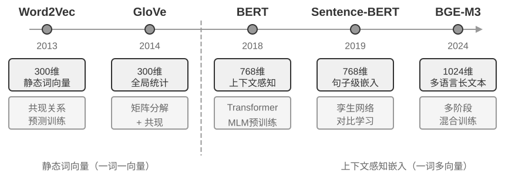
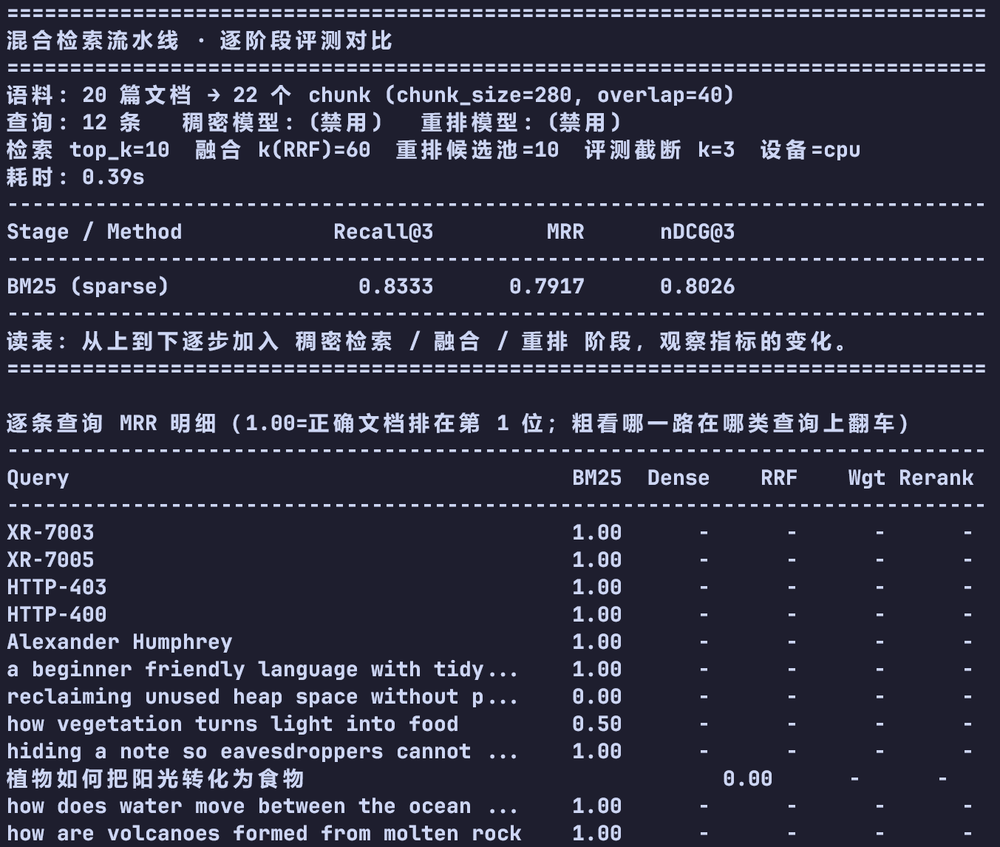
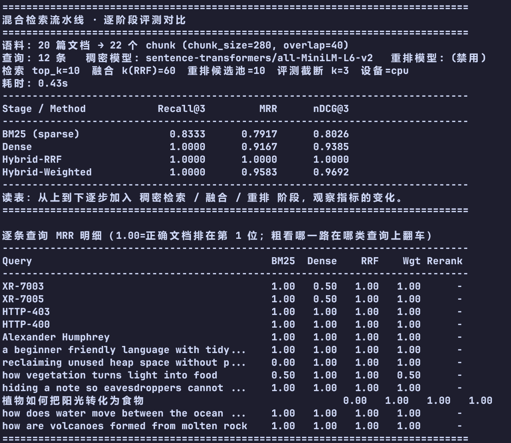
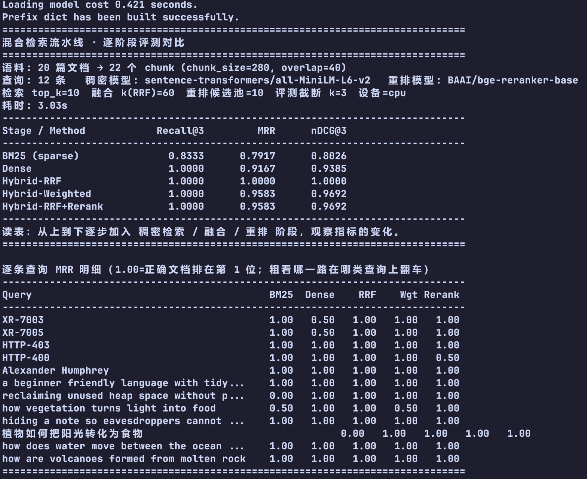

# 用户记忆和知识库

如何让agent记住用户和知识

**用户记忆**，**知识库**

向量检索，知识压缩

信息冲突，知识过期，检索不准

记忆系统和RAG系统

## 用户记忆系统

疑问这个记忆系统和agent中的context上下文的关系是什么？

回答：是完成一次对话之后额外调用一次llm将context中有关user的内容提炼出来,单独保存为一个文档，存放用户相关的偏好。其实和agent的状态管理和context上下文压缩有共通之处，就是将关键信息提取出来，提高llm对这些信息的注意力。

这个提取的三条规则不太懂。不知道这个最后提炼的llm的提示词该怎么写

### 记忆能力的评估：三层次框架

先有评估标准（统一的），然后才能统一的比较不同记忆系统的好坏。**LoCoMo**（Long-term Conversational Memory，长期对话记忆），感觉类似数据集一样。

> 是一套**“超长对话记忆”的评测基准（benchmark）**——它包含数据集、任务定义和评测指标三部分，2024 年由 UNC 与 Snap 的研究者提出（Maharana 等，[arXiv:2402.17753](https://arxiv.org/abs/2402.17753)，[项目主页](https://snap-research.github.io/locomo/)）。它要回答的问题是：**当模型需要处理几十个会话、9K token 量级的历史时，它还能不能“记住”并答对？**

用户记忆能力，这让我想到了最近的各个个人agent产品，Grok Bot、Meta Muse、OpenAI Dots、开源的 OpenClaw、DeepSeek Bot——它们与用户记忆能力的关系，见 [01 · Personal Agent 与用户记忆](chapter3相关文档/01-personal-agent-memory.md)。

### 记忆的层次结构

**轨迹（Trajectory）** 只增不改，用于回溯

这里有疑问，trajectory是只增不减少，但是后面context可以压缩重组和用摘要替换部分历史：这里理解只增不改指的是将这些信息保存到一个轨迹日志里面，方便回溯和查找原因，context用于输入给llm。

高效处理当前任务(依赖轨迹)，长期个人能力(依赖长期记忆)

### 用户记忆的四种存储格式

### 进阶知识表示形态：可执行代码

### 用户记忆的认知科学基础

工作记忆（上下文窗口），长期记忆（1.情景记忆，2.语义记忆，3.程序记忆）

> 选择哪种格式取决于工程需求（简单性与表达力之间的取舍），选择存什么类型取决于业务场景（需要记住事实、事件还是流程）。

### 记忆框架案例

- **v2（2025 论文）**：写完立刻“定稿”——抽取事实 → 找相似旧记忆 → 让 LLM 判断 `ADD / UPDATE / DELETE / NOOP` → 落库。库里永远只有“当前真相”，旧的被覆盖或删掉。
- **v3（2026 年 4 月）**：写完只追加（ADD-only）→ 查询时用语义、BM25、实体、时间四路信号混合检索 → 取 Top-k 交给读懂时间的模型去判断哪条有效。库里保留“全部历史”。

> 实际框架往往只实现其中一两种类型——按业务需要取舍，比追求“大而全”更符合工程现实。

### 记忆压缩与整理机制

简单的累计式存储不仅会降低存储空间，还会降低检索效率

1.对不同记忆评分然后找出top-k的记忆，

2.相似的记忆放到一个分组

3.抽象和泛化

### 隐私保护：日志脱敏

## RAG 基础：构建 Agent 的知识获取管道

RAG,检索器和生成器（添加上下文中，传给llm）

### 文档分块（Chunking）

如何分块：

1.固定大小（固定token数，然后块与块之间有重叠部分）

2.递归/结构感知切分（先按文章标题，段落，句子进行粗分块，如果还是超出就按固定分块）。markdown,html这种显示结构适合分块

3.语义切分（额外计算相似度，在相似度低处切割）

### 稠密嵌入：从词汇关联到语义理解

嵌入（文档分块后，经过向量化之后存入向量数据库）

什么是稠密，什么是稀疏

相对而言，稠密向量有更多维度不为0，稀疏向量有更为维度为0

稠密检索（语义检索），用向量距离（余弦相似度）

稀疏检索（关键词检索）

#### 从 Word2Vec 到上下文感知

ANN可以在百万条信息中根据索引快速查找

### 稀疏嵌入：精确匹配的关键词检索

稀疏嵌入（关键词匹配）

IDF 词频在文档出现频率越低，IDF越高，区分度也就越高

$$\text{TF-IDF}(t, d) = \text{TF}(t, d) \times \text{IDF}(t), \qquad \text{IDF}(t) = \ln\frac{N}{\text{DF}(t)}$$

从TF-IDF到BM25的优化

1.根治线性TF,2.长度归一化3.改写IDF

$$\text{IDF}_{\text{BM25}}(t) = \ln\frac{N - \text{DF}(t) + 0.5}{\text{DF}(t) + 0.5}$$

$$\text{Score}(Q, D) = \sum_{i} \text{IDF}_{\text{BM25}}(q_i) \cdot \frac{\text{TF}(q_i, D)\,(k_1+1)}{\text{TF}(q_i, D) + k_1\left(1 - b + b \cdot \frac{|D|}{\text{avgdl}}\right)}$$

#### 从 TF-IDF 到 BM25

### 混合检索：两全其美的艺术

两者并行跑，关键是结果如何合并

合并的方式有RRF,

> **实验 3-6 ★★：混合检索流水线：结合稀疏、稠密与重排序**
>
> `retrieval-pipeline` 项目构建了一套完整的教育性检索流水线，包含稠密检索、稀疏检索和神经重排序。`test_client.py` 中包含一系列测试案例，每个都旨在突出一种特定的信息检索挑战。
>
> `test_client.py` 中的测试案例，正对应前面“混合检索”一节指出的几类挑战——语义相似（如“kitty”对“feline/cat”）、精确名称、多语言查询、技术代码——可直接观察稠密与稀疏两路在每类查询下各自的胜负，此处不再逐一复述例子。
>
> 最引人注目的是重排序器在提升最终结果质量上的显著作用。系统不仅返回重排序列表，还详细展示每个文档在原始稠密和稀疏检索中的排名以及重排序后的变化。通过分析这些“排名变化”数据，可清晰看到神经重排序器如何智能地将被单一方法低估但实际高度相关的文档提升到顶端。实验结果清楚地说明：没有哪种单一检索策略在所有场景下都可靠。把稠密、稀疏和重排序组合起来，才是构建生产级 RAG 系统的正确做法。

① 纯 BM25（零下载，秒出）

② 加稠密检索

③ 加神经重排（完整流水线）

**实测结论（2026-10-18，20 篇文档 / 22 chunk / 12 查询，CPU）**

| Method | Recall@3 | MRR | nDCG@3 |
|---|---:|---:|---:|
| BM25 (sparse) | 0.8333 | 0.7917 | 0.8026 |
| Dense (all-MiniLM-L6-v2) | 1.0000 | 0.9167 | 0.9385 |
| **Hybrid-RRF** | **1.0000** | **1.0000** | **1.0000** |
| Hybrid-Weighted | 1.0000 | 0.9583 | 0.9692 |
| Hybrid-RRF + Rerank (bge-reranker-base) | 1.0000 | **0.9583 ↓** | **0.9692 ↓** |

**逐条 MRR（关键对照）**

| 查询 | BM25 | Dense | RRF | Wgt | Rerank |
|---|---:|---:|---:|---:|---:|
| `XR-7003` / `XR-7005`（精确编号） | **1.00** | **0.50** | 1.00 | 1.00 | 1.00 |
| `reclaiming unused heap space…`（语义） | **0.00** | 1.00 | 1.00 | 1.00 | 1.00 |
| `植物如何把阳光转化为食物`（跨语言） | **0.00** | 1.00 | 1.00 | **0.50** | 1.00 |
| `how vegetation turns light into food` | 0.50 | 1.00 | 1.00 | **0.50** | 1.00 |
| `HTTP-400`（错误码） | 1.00 | 1.00 | **1.00** | 1.00 | **0.50 ↓** |

**三个发现**

1. **BM25 与 Dense 互补且各有死穴**：BM25 精确编号 1.00、语义/跨语言 0.00；Dense 语义 1.00、精确编号 0.50（把相邻型号排到前面）。
2. **RRF 融合最稳**：用**排名**（`1/(k+r)`）而不是原始分数，天然避开两种检索器的量纲问题 → 全部 12 条 MRR = 1.00。
3. **重排不是"加了就更好"**：RRF 已经 MRR 1.00 时，重排在 `HTTP-400` 上把正确文档从第 1 压到第 2（1.00 → 0.50），整体 MRR 降到 0.9583。说明**召回已经足够好时，重排可能画蛇添足**——书里"先查召回、再看重排"的原则在此得到验证。

**工程启示**

- 先做**召回覆盖**（混合检索），再考虑重排；
- 融合优先用 **RRF**（对分数量纲不敏感）；
- 每次只加一个阶段并记录指标——**不是流水线越长越好**。

## 超越扁平文本：知识的组织与检索

六个非递进式主题，

两种结构化索引（RAPTOR,GraphGAG）

OpenViking的文件系统范式

知识何时更新

智能化RAG(Agentic RAG)

上下文感知和检索

**把原始案例或文档不加处理地直接放进知识库是远远不够的**

在索引阶段就要进行处理和提炼

### 结构化索引：从信息检索到知识建模

PAPTOR类似先将内容分为大的主题，然后在在每个大的主题下划分

比如，将地球先划分为各个国家，然后中国内部划分为各个省份，省份划分为各个市

核心思想市聚类。

GraphRAG实体和关系构成知识图谱，

**多跳关系推理。**

**实体消歧（Entity Disambiguation）。**

操作：先提取实体，在提取关系，构建图谱。

缺点：语义降级。

先混合检索，如果不能解决再上结构化索引（缺点会额外调用llm，增加开销）

### 文件系统范式：用目录结构组织知识

OpenViking(虚拟文件系统)

agent skill 三层加载机制

### 知识应该如何更新

两种触发更新：事件触发的增量更新和周期触发的全量整理

#### 用户记忆和知识库的增量更新

把知识库当成代码库，用git进行版本管理，就像code is everything

#### 用户记忆和知识库的定期整理

**全量整理**

**去重、去旧与合并。** 

**回到原始数据核查。** 

**冲突解决与场景限定（qualification）。** 

### 智能体化 RAG：将知识检索工具化的范式转变

Agent如何使用这个知识库

Agentic RAG

RAG内部检索会是一个ReAct,调用工具进行多轮检索，直至信息充足，才返回。

RAG的安全

### RAG 技巧：上下文感知检索

在对文本进行索引之前用llm把该段文本的前后生成一段摘要，将摘要和文本打包然后再索引。有点类似论文的摘要，或者上下文压缩（但是不对上下文产生影响）。

同时增强稠密检索（添加了文本缺失的语义背景，增强语义）和稀疏检索（增加可精确匹配的关键词）。

### 从数据集中提取深度知识：从信息检索到知识发现

知识都以非结构化或半结构化的文档存储

### 前沿探索：多模态记忆

图片，视频，音频，文本混合的记忆

## 本章小结

## 思考题
