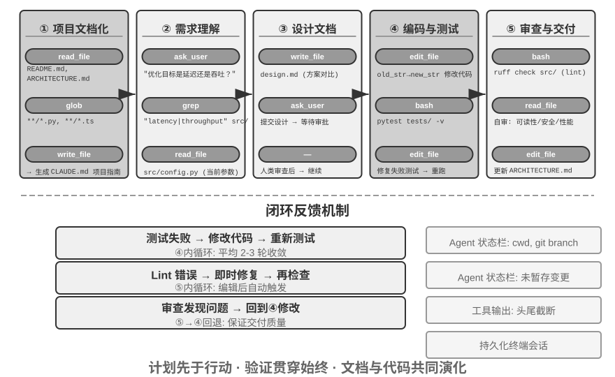
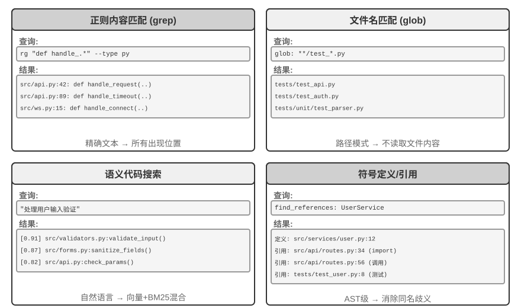

# Coding Agent 与通用 Agent

## Coding Agent

主要是claude code，codex, coding is everything，配上代码编写和执行就可以根据需要构造工具

### Coding 是 Agent 的基础能力

文件操作的工具，类似linux的文件指令

coding能力作为一种通用能力，可以根据具体问题现场构造这个工具，工具扩展，agent能力扩展。

### 案例：从 Manus 到 OpenClaw——通用 Agent 的 Coding 内核

DeepResearch 搜索能力，Computer Use，提高agent的权限，Coding agent，提高agent的工具，也就是能力边界，二前两者的能力可以通过coding agent实现，也就是自进化harness

短期记忆存在上下文，长期记忆用文件系统管理

### Coding Agent 的整体流程

通用流程值得学习

项目文档化，需求理解（需求分析），文档设计，编码和测试，审查和交付

这个过程和传统**软件工程的流程**好像，只不过把人换成了agent或llm

**项目文档化。**

CLAUDE.md、AGENTS.md、.cursorrules这些信息在每轮对话都会被加入上下文，相当于强制将模型注意力集中在这上面。

这个agent的内容怎么管理值得学习，

> 这也正是第二章“对远程工作友好的团队往往也对 AI Agent 友好”那条判断在代码库层面的落点：决策记录在文档里，上下文写在 issue 和 PR 描述里，内部经验沉淀在开发者指南里，Agent 才读得到。由此可以给出一个评估团队“AI-ready”程度的简单指标：**一个远程新人只靠代码仓库和文档，能不能独立开展工作。**

**任务理解与需求澄清。**

复杂性来源于：1.需求本省模糊，用户不是专业的程序员，2.可以实现的路径很多，比如python,java，CPP，或者功能很多。

调研和需求分析

> 例如，当用户要求 “优化系统性能” 时，Agent 需要先搞清楚：优化的具体目标是什么（降低响应时间、减少内存占用还是提高吞吐量）、可接受的权衡是什么（是否允许修改接口、是否允许降低用户易用性）、以及当前瓶颈在哪里。在需求模糊的状态下就开始编码，往往导致大量返工。

**编写设计文档。**

按经典软件工程阶段可写成：

**问题定义 → 可行性研究 → 需求分析 → 设计 → 实现 → 测试 → 部署 → 维护**

所以可行性分析不是一个独立于前期规划之外的后期步骤，而是前期规划中的关键环节，主要评估：

- 技术可行性
- 经济可行性
- 操作/运行可行性
- 法律与合规可行性
- 进度可行性

**代码实现与测试。**

> 实现完成后立即进入测试驱动的质量保障环节——为新增或修改的功能编写测试用例，覆盖正常路径、边界条件和异常情况。

如何避免coding agent偷懒，loop engineering 决定agent什么时候停止，什么时候需要继续迭代。

写测试，代码审查

**文档同步与交付。**

关键是如何管理新旧文档，是在之前的基础上直接修改，还是另外保存一份，然后用版本号管理

> 计划先于行动，验证贯穿始终，文档与代码共同演化

### Harness 工程在 Coding Agent 中的实践

这里的约束，验证，纠正可以和之前的软件工程的流程对应起来

约束时需求分析，验证时编写测试用例和审查，纠正是测试用例和审察不通过时修改代码

**任务清晰度和验证自动化程度**

> |              | 结果可自动验证                       | 结果需人工验证                 |
> | ------------ | ------------------------------------ | ------------------------------ |
> | **目标明确** | 最佳区域：修复有测试用例的 bug       | 吞吐量受限：代码重构需人工审查 |
> | **目标模糊** | 高效地跑偏：用 linter 优化“代码质量” | 难以启动：“让 UI 更好看”       |

**从 Coding Agent 到通用 Harness 设计原则。**

> Coding Agent 的 Harness 实践为所有 Agent 系统提供了可迁移的设计原则：
>
> 1. **约束优先于指导**：能用代码强制的规则就不要用文档建议。Linter 规则、类型约束、CI 检查的价值远超系统提示词中“请遵循...”式的指导——前者是“做不了”，后者只是“建议别做”。
> 2. **验证要自动化**：人工审查是不可扩展的瓶颈。测试套件、代码质量检查、行为监控——这些基础设施的投入回报率远高于增加人力。
> 3. **反馈越快越好，越结构化越好**：错误信息越详细、越接近错误发生的时刻，Agent 的纠正效率越高。第二章的 Agent 状态栏技术（详细错误信息、工具调用计数器）正是这一原则的体现。
> 4. **回退要可靠**：Agent 在安全网内操作才能大胆试错。Git 分支、沙盒环境、快照机制确保任何错误都可逆。

### 故障与错误恢复

故障分为四类
**api层**

以deepseek为例

| 你列的情况   | DeepSeek API 表现                        |
| :----------- | :--------------------------------------- |
| 限流         | HTTP **429**                             |
| 服务过载     | HTTP **503**（或 500/502）               |
| 请求超时     | HTTP **504** / 客户端超时                |
| 连接中断     | 无 HTTP 码，网络层异常                   |
| 输出触顶截断 | HTTP **200** + `finish_reason: "length"` |

**工具层**

最严重的错误：

> 工具反复返回同一个错误，而模型不加改变地反复重试。

我在给agent写rag检索工具的时候，就遇到过这种情况，rag没有检索到想要的就继续检索，结果就一直卡在这里。

**上下文层**：最常见的是上下文溢出，还有压缩失败(剩余的空间不足以额外调用大模型来进行总结)

**控制流层**：死循环与死亡螺旋

> **错误处理的边界不是单次请求，而是整个恢复循环**

**接管**

> 由此可以得到一条设计原则：轨迹不该按任何一家的接口格式存储，而应保存为一份中立格式。

> **实验 5-1 ★★★：跨厂商的轨迹接管**

> **实验 5-2 ★★：输出到一半断掉之后的接续**

**终止：每条恢复路径都要有上限。**

有最大的重试调用的次数（预算有限）

### Coding Agent 的实现技巧

> **并行工具调用、流式执行与级联中止。**

当并行调用多个工具时，其中一个失败了应该怎么处理

> **上下文的精细化管理。**

几十，几百万行的代码，当前1M上下文窗口不够用。

> 这五个实现技巧——并行与流式、上下文管理、环境感知、状态持久化、即时反馈——共同构成了高效 Coding Agent 的技术基础。

### Coding Agent 中的搜索工具

### Coding Agent 中的文件编辑工具

这个文件编辑工具

### Coding Agent 的安全

## 代码：通用 Agent 的元能力

### 代码作为思考工具

### 代码作为业务规则的约束

### 代码驱动的多媒体生成

### 代码作为系统适配器

### 代码作为生成式 UI

### 代码创造代码：Agent 自举

## 本章小结

## 思考题
